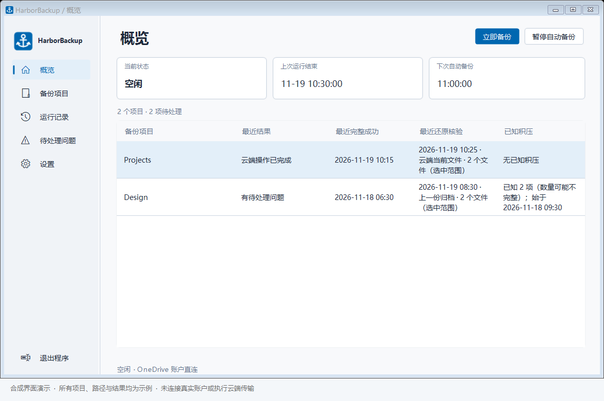

# HarborBackup · 泊岸备份

[English](README.en.md)

将 Windows 文件夹备份到个人 OneDrive，保留原文件名和目录。HarborBackup 提供桌面窗口、托盘自动备份和 CLI，通过 Microsoft Graph 直连授权账户，无需安装 OneDrive 同步客户端。

## 能做什么

- 每个项目选择本地文件夹和独立的云端目标，支持预览、排除规则与按文件确认上传或取回。
- 自动备份不修改源文件，取回不修改云端正文，两者都不传播删除。
- 以共同基线识别单边和双方修改；双方修改需要明确选择，覆盖前保护不同内容，核验后提交共同基线。
- 普通历史保留上一份；冲突副本和未完成恢复材料另行保留。可将当前文件或上一份历史恢复到独立目录，并下载正文核验。
- 支持备份间隔、暂停、内容和时间预算、上传/下载限速，以及项目保护状态、运行记录和 JSON 报告。

## 界面演示

<a href="docs/user-guide/demo.zh-CN.md"></a>

图中为合成项目和实际控件，未执行真实 OneDrive 账户传输。查看[五步界面演示](docs/user-guide/demo.zh-CN.md)，了解项目预览、上传保护与独立恢复。

## 平台与边界

当前面向 Windows x64，使用 C#、.NET 10 和 WinForms；账户连接面向个人 Microsoft OneDrive。

备份正文是普通云端文件，不是整机镜像；NTFS 权限、备用数据流和链接语义不属于备份格式。普通比较和“完整核查”使用本地摘要及云端版本元信息，不下载云端正文；独立恢复和恢复演练才下载正文并核验。普通历史仅保留上一份，不提供任意时间点快照。

0.4 / PowerShell 配置和旧数据不自动导入。首次使用、升级和恢复规则见[使用说明](docs/user-guide/onedrive-account.zh-CN.md)。

## 安装与首次使用

若本仓库的 **Releases** 页面已提供安装包，下载对应版本的 `HarborBackup-<版本>-Setup-x64.exe`，按该版本说明核对 SHA-256、签名状态和验证范围。源码压缩包不是安装包；没有发布资产时可按下方说明从源码构建。

安装包按当前用户安装，默认位于 `%LOCALAPPDATA%/Programs/HarborBackup`，自带所需 .NET 运行时。程序位于 `app`，本机配置、凭据和恢复状态位于 `data`；升级和卸载保留 `data`。

1. 打开“设置 → 账户与管理目录”，连接 OneDrive，选择保存元信息、历史和冲突材料的管理目录。
2. 添加备份项目，选择本地文件夹和另一个普通云端目标目录。
3. 核对预览，完成首次手动上传或取回后，再使用自动备份。

授权缓存按当前 Windows 用户加密保存在本机，不同步到云端。完整操作与 CLI 示例见[中文指南](docs/user-guide/onedrive-account.zh-CN.md)和[英文指南](docs/user-guide/onedrive-account.en-US.md)。

## 从源码开发

需要 Windows、Git、PowerShell，以及 [global.json](global.json) 允许的 .NET 10 SDK。`Use-DotNet.ps1` 配置仓库内缓存，SDK 须先自行安装。首次还原需要访问 NuGet。

在仓库根目录运行，测试前从托盘退出已运行的 HarborBackup，并等待 CLI 操作结束：

```powershell
. ./scripts/build/Use-DotNet.ps1
& $HarborDotNet restore HarborBackup.slnx --configfile NuGet.Config --locked-mode
& $HarborDotNet build HarborBackup.slnx -c Release --no-restore
./scripts/test/Test.ps1 -Configuration Release -IsolatedProfile
```

完整的环境准备、开发启动、Inno Setup 下载与隔离安装验证见[从零开始开发](docs/development/getting-started.md)。普通构建和合成测试不需要真实 OneDrive 账户。

## 文档与贡献

- [文档索引](docs/README.md)：当前用户指南、设计和历史资料。
- [贡献指南](CONTRIBUTING.md)：工程边界、提交内容和验证要求。
- [隐私说明](PRIVACY.md)、[安全问题报告](SECURITY.md)与[使用支持](SUPPORT.md)。
- [当前传输协议](docs/architecture/onedrive-account-transport.md)与[安装布局](docs/architecture/storage-layout.md)。
- [验证记录索引](docs/development/validation-index.md)：各版本实际验证过的范围与未测项；历史通过记录不代表当前源码或安装包已通过相同验收。
- [公开发布检查表](docs/development/open-source-checklist.md)：发布前的代码、文档和资产检查。

源码版本见 [Directory.Build.props](Directory.Build.props)。请勿提交本机配置、凭据、真实业务路径、日志或构建产物。

项目采用 [MIT License](LICENSE)。第三方组件保留各自许可，见 [packaging/licenses](packaging/licenses)。变更摘要见 [CHANGELOG](CHANGELOG.md)。
