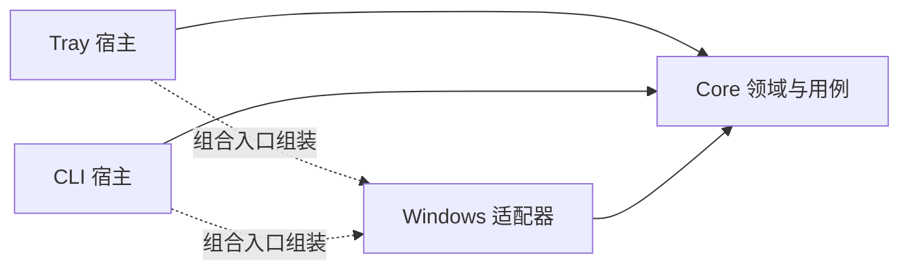

# 架构设计

## 采用原则

单一职责：策略、外部能力和交互入口分别维护。依赖倒置：Core 定义所需能力，Windows 实现。低耦合高内聚：变化围绕完整用例收敛。保持简单：不用通用仓储、事件总线、插件框架或多进程服务支撑第一版。

箭头表示编译依赖，不表示执行顺序。Core 不依赖注册表、WinForms、具体文件路径 API 和 JSON DTO。

## 模型与端口

候选模型：FileObservation、FileVersion、ComparisonBaseline、PlannedAction、RunRequest、RunResult、PendingIssue。名称在实现时可调整，不把文件缓存 DTO 直接作为领域对象。

观察结果应区分存在、不存在、无法访问、不稳定和未知类型。缓存命中的哈希与本次实际读取的哈希需要携带可信度信息。

候选端口包括文件观察、文件事务提交、状态存储、事务存储、运行锁和时间。接口针对完整能力设计，不为每个辅助类添加接口。哈希与复制如何共享流、扫描如何分批属于适配器实现细节。

## 用例流程

共享 BackupRuntime 在宿主工作线程取得运行锁并加载配置 → BackupService 检查恢复记录 → 建立观察 → 纯决策 → 执行前重检 → IBackupSession/FileBackupSession 文件事务 → 状态与日志。PreviewService 使用只读端口，维护仍待迁移。

预览通过只读分支报告未完成事务，不自动恢复。CLI 状态查询当前同样取得兼容锁；托盘空闲时读取状态，读取文件容忍版本更替，不把跨文件快照当作强一致。

决策输出包括动作、原因、方向、预期版本、归档分类和问题标记。时间仅用于既定版本取舍，不作为内容身份；内容身份使用 SHA-256。

## 并发与生命周期

第一版采用单个写入执行器，先保证事务顺序正确。扫描与哈希并发只有在指标与测试支持时再引入，避免对 OneDrive 占位文件造成无界下载。

托盘实例锁防止重复托盘，运行锁覆盖 Backup、Pull、恢复、会修改保护信息的维护；托盘空闲时释放运行锁。兼容期接入旧脚本互斥，详见 compatibility.md。

Windows Mutex 具有线程归属，获取/释放必须在符合该约束的执行路径上进行，不能任意跨 await 使用。托盘与 CLI 直接竞争同一运行锁；桌面实例之间通过当前用户命名管道发送显示窗口或安全退出请求，不通过 IPC 转发备份任务。安装增量另用 Startup/Running/Maintenance 标记协调文件升级，详见 [ADR-0006](decisions/0006-self-contained-installer.md)。

自动触发到点若忙碌则跳过，不积压。休眠恢复至多补一次到期运行。暂停只阻止自动触发，手动执行仍可用。退出停止接受新任务，在安全边界取消；系统强制终止依靠恢复协议。

托盘通过 ApplicationContext 管理生命周期，手动启动打开主窗口，后台启动按需显示；耗时任务在后台执行，进度节流后回到 UI 线程。关闭主窗口不退出托盘。

主窗口增量将生命周期留在 TrayContext，调度和操作移到 DesktopController；主窗口、托盘共享 DesktopState、RunCoordinator 和 BackupRuntime。ConfigurationPresenter 调用 Windows 的配置草稿编辑器；配置的文件读取与内存解析共用校验。详细选择见 [ADR-0005](decisions/0005-desktop-configuration.md)。

## 错误和维护

错误按文件、项目、运行分类。单文件暂时错误可延期；配置映射冲突和状态损坏阻止受影响范围写入。未知协议不能按空状态继续。

普通归档清理与空间释放是后续维护，失败不会抹掉已完成的文件提交。重试使用有限次数和明确原因；不无限重试磁盘不足、权限或未知格式。

运行结果包含稳定错误码和各类数量，文本日志是诊断材料，不参与冲突决策。按 runId、taskId、transactionId 关联诊断。
