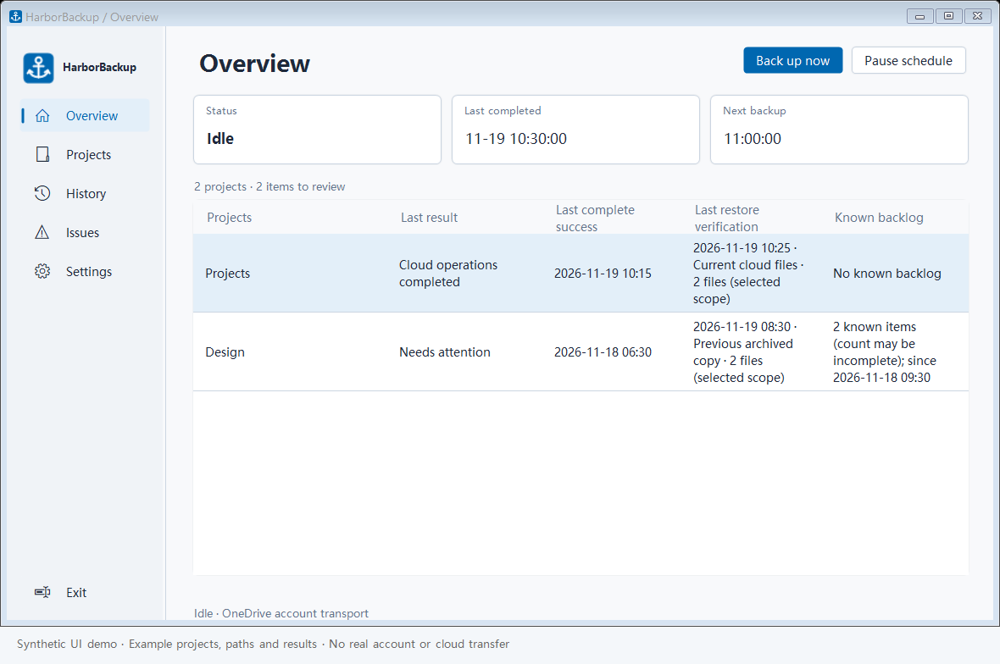
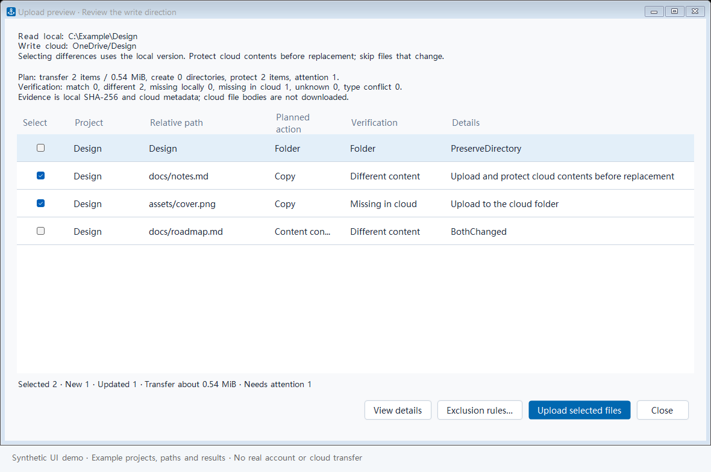
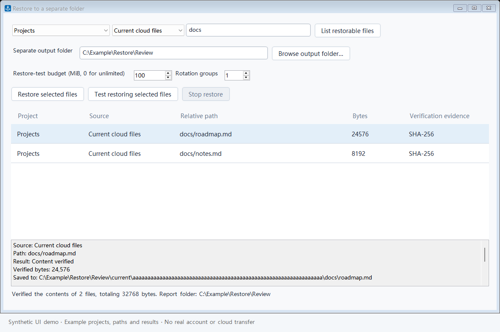
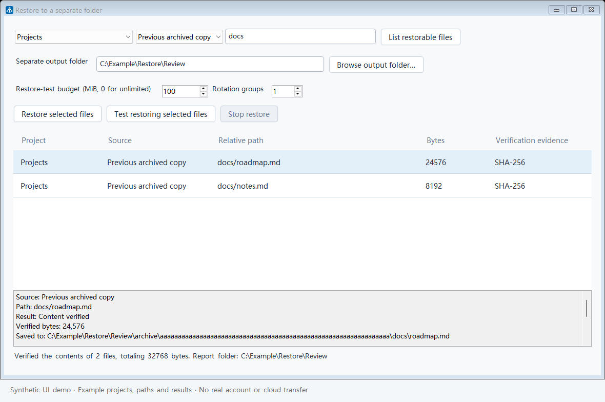

# UI walkthrough: preview a project and restore separately

[简体中文](demo.zh-CN.md) · [Full user guide](onedrive-account.en-US.md)

These images show HarborBackup's actual WinForms controls populated with synthetic projects, example paths and synthetic results. The demonstration did not connect a real OneDrive account or upload or download account contents. Success indicators in the images are not evidence of real cloud transfers or installed-release acceptance.

[View the four-frame synthetic slideshow (GIF)](../media/showcase.en-US.gif): overview, upload preview, current-file restore and previous-archive restore. It cycles through static UI images rather than recording a real backup operation.

## 1. Choose a project and establish its initial mapping

For actual use, connect an account under **Settings > Account and management folder**, then choose a local folder and an ordinary cloud destination under **Projects > Add project**. The separate management folder holds metadata, history and conflict materials.

Saving a project does not establish a common baseline or enable automatic work for a new mapping. Review the contents and complete an explicit initial upload or pull. The overview shows complete-run success, restore-verification scope and known backlog separately.

## 2. Preview the direction and protection plan

Select a project and choose **Preview** for a read-only plan. **Back up selected** opens the upload preview: review the local source, cloud destination, selected files, transfer size and protection of existing contents. Preview does not transfer files. Changes on both sides, or missing common evidence, require an explicit choice. Files whose versions change after preview are skipped for another review.

## 3. Protect existing contents before uploading

In an actual operation, **Upload selected files** protects different cloud contents, uploads and verifies the chosen local files, then commits their common baseline. Backup leaves local source files unchanged; Pull leaves cloud file bodies unchanged. Neither operation propagates deletions.

Ordinary history retains one previous copy. Unresolved conflicts and unfinished recovery materials are retained separately. The preview above illustrates a synthetic protection plan and performs no real cloud replacement.

## 4. Restore into an independent folder

Open **Issues > Restore to a separate folder**. Choose the project, source and optional relative path prefix, list restorable files, then select the rows to restore. Current cloud files and the previous archive are separate sources; changing the selection filters requires listing candidates again.

The output folder must be separate from project sources, application files, data and protection locations. Existing output paths are never overwritten. Restores and restore tests do not alter common baselines or initialize automatic work for a new mapping.

## 5. Distinguish metadata checks from content evidence

| Operation | Evidence checked | Downloads cloud file bodies |
| --- | --- | --- |
| Read-only full check / CLI `verify` | Local SHA-256 and version-checked cloud metadata | No |
| Independent restore / CLI `restore-test` | Cloud versions before and after downloading, plus SHA-256 of downloaded contents | Yes, within the explicitly selected scope |

**Test restoring selected files** accepts a byte budget and rotating groups. Each run creates a fresh directory and retains recovered files and a JSON report. Missing trusted SHA-256 evidence, changed versions, failed checks and budget-skipped files do not count as verified. Increase the budget to check a file larger than the per-run limit.

The displayed results are synthetic. After a real run, inspect each file's result, source, verified bytes and report. The latest restore-verification time describes only the reported sample, rather than confirming that every project file was checked.

See the [full user guide](onedrive-account.en-US.md) for account setup and recovery rules, and the [validation index](../development/validation-index.md) for each release's actual verification scope.
