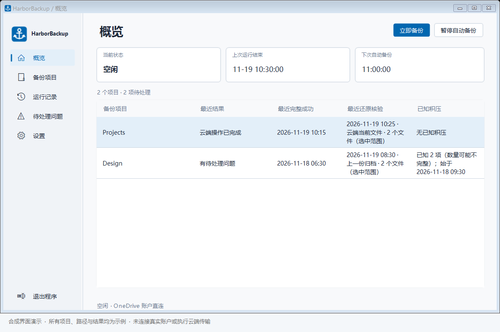
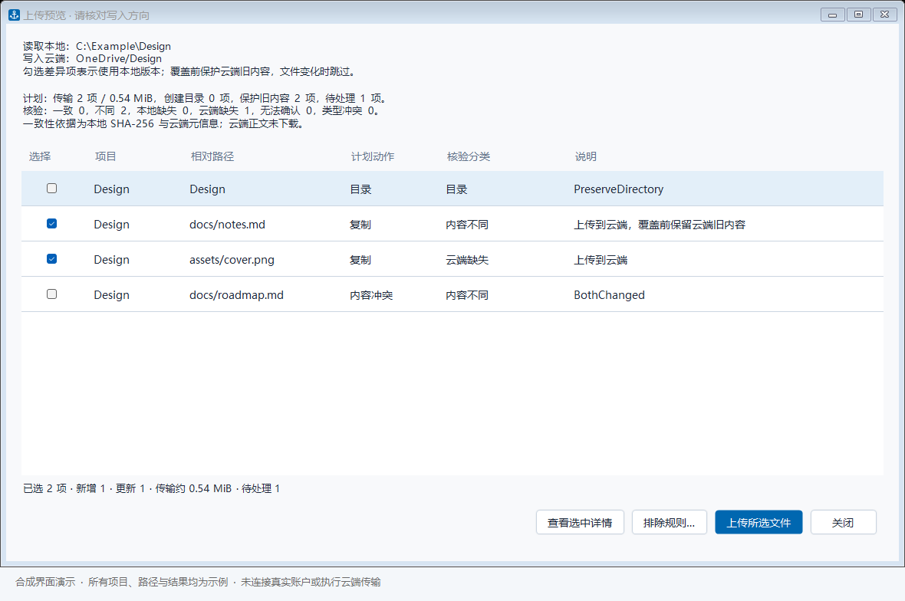
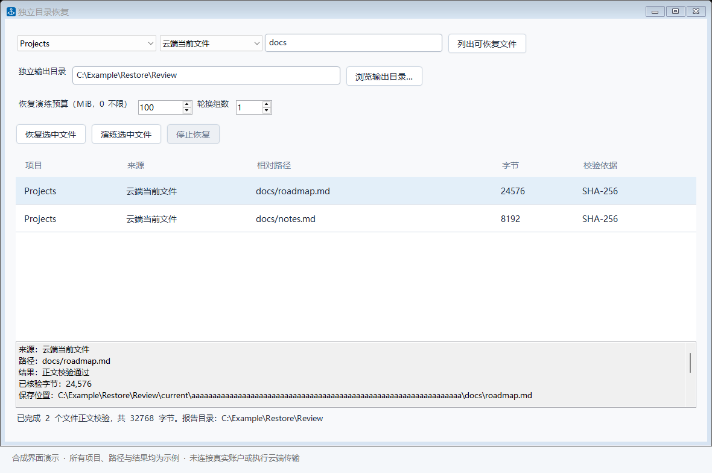
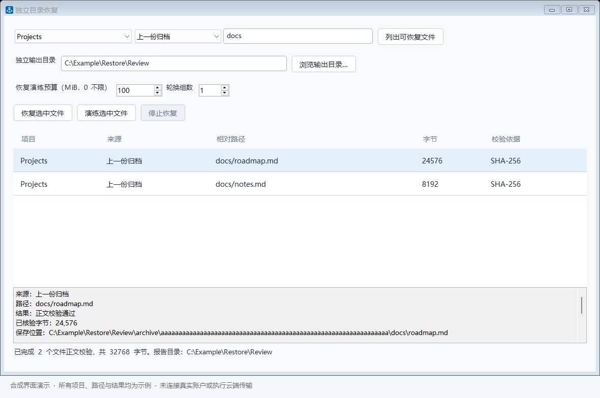

# 界面演示：从项目预览到独立恢复

[English](demo.en-US.md) · [完整使用指南](onedrive-account.zh-CN.md)

这些图片展示 HarborBackup 实际 WinForms 控件，内容为合成项目、示例路径和合成结果。演示未连接真实 OneDrive 账户，也未执行真实账户上传或下载；图片中的成功状态不能作为云端传输或安装版验收证据。

[查看四画面合成轮播（GIF）](../media/showcase.zh-CN.gif)：概览、上传预览、当前文件恢复、上一份归档恢复。这是静态界面的轮播，不是真实备份操作录屏。

## 1. 选择项目并确认首次映射

实际使用时，先在“设置 → 账户与管理目录”连接账户，再到“备份项目 → 添加项目”选择本地文件夹和普通云端目标。管理目录保存元信息、历史和冲突材料，与项目正文目录分开。

保存项目不会建立共同基线或激活新映射的自动备份。首次需核对内容，并完成一次明确的手动上传或取回。概览会分别显示最近完整成功、恢复核验范围及已知积压。

## 2. 预览方向与保护计划

选中项目，点击“预览上传”查看只读上传计划；点击“上传选中”进入上传预览，核对“读取本地 / 写入云端”、勾选文件、传输量和旧内容保护安排。预览不会执行传输。双方均有修改或缺少共同证据时，需要明确选择；预览后版本变化的文件会跳过并等待重新核对。

## 3. 上传前保护旧内容

真实操作中，确认“上传所选文件”后，软件先保护不同的云端内容，再上传并核验，成功后才提交共同基线。备份不改本地源文件，取回不改云端正文，两者都不传播删除。

普通历史只保留上一份；未解决冲突和未完成恢复材料另行保留。上图展示的是合成保护计划，没有执行真实云端覆盖。

## 4. 恢复到独立目录

打开“待处理问题 → 独立目录恢复”，选择项目、来源和可选的相对路径前缀，点击“列出可恢复文件”，再选择要恢复的行。可分别浏览“云端当前文件”和“上一份归档”；改变筛选范围后需重新列出。

输出目录必须独立于项目源、程序、数据和保护目录，已有输出不会被覆盖。普通恢复与恢复演练均不改共同基线或新映射的就绪状态。

## 5. 区分元信息核查与正文证据

| 操作 | 核查依据 | 下载云端正文 |
| --- | --- | --- |
| “完整核查（只读）” / CLI `verify` | 本地 SHA-256 与受版本核验的云端元信息 | 否 |
| 独立恢复 / CLI `restore-test` | 下载前后云端版本与下载正文的 SHA-256 | 是，仅显式选择的范围 |

“演练选中文件”可设置字节预算和轮换组数，每轮创建新目录并保留恢复文件及 JSON 报告。缺少可信 SHA-256、版本变化、校验失败或预算未覆盖的文件不会算作通过。超过单轮预算的文件需增加预算后核验。

图片中的结果是合成展示。真实运行后，应查看每个文件的结果、来源、已核验字节和报告；“最近恢复核验”只说明报告所列样本，不能证明整个项目均已检查。

查看[完整使用指南](onedrive-account.zh-CN.md)了解账户配置和恢复规则；各版本的实际验证范围见[验证记录索引](../development/validation-index.md)。
